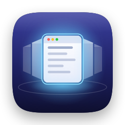

# Swivel

A menu bar app for ultrawide monitors. The window you focus glides to the middle of the screen, right in
front of you, and every other window is tiled neatly on either side. No dragging windows around, no turning
your head to read the edges.

## How it works

- Focus a window any way you like (click it, ⌘-Tab, open a new one) and it moves to the center slot.
- By default it trades places with the window that was there, so only two windows move. Pick
  **Rotates the Whole Row** in the menu for a carousel instead.
- The other windows split the space on either side, and stack into rows when there are too many to stay readable.
- Scrolling a side window doesn't focus it, so you can read them without anything moving.
- Each Space is tiled on its own. Swivel tiles the widest display.

**Smooth transitions.** macOS only lets one app move another app's windows by asking that app to do it,
and most apps (Electron and Chrome especially) redraw slowly while being resized. So Swivel snapshots the
screen, rearranges the real windows behind an overlay, and animates the snapshot with Core Animation at the
display's refresh rate. Once the real windows have redrawn in their new places, Swivel takes a second
snapshot and fades into it while the windows land, so the overlay ends up identical to the screen and
handing back to the real windows is invisible. This needs Screen Recording permission. Snapshots only
exist in memory for the length of one transition. Without the permission, windows snap into place.

A glow marks the focused window, and side windows can be dimmed (menu → **Dim Side Windows**).

## Install

```bash
Tools/make-signing-cert.sh   # once
./build.sh --install
```

The first script creates "Swivel Local Signing", a self-signed certificate in your login keychain. Every
build is signed with it, so macOS keeps Swivel's permissions across updates. The second builds the app,
copies it to /Applications, and opens it. On first launch, Swivel adds itself as a login item (toggle it
in the menu).

Permissions, in System Settings → Privacy & Security:

- **Accessibility** (required): to move windows.
- **Screen & System Audio Recording** (optional): for smooth transitions.

Without the certificate, builds are ad-hoc signed and macOS forgets both permissions after every rebuild.
Toggling Swivel off and on isn't enough then: remove it from each list and add it again, or run
`tccutil reset Accessibility local.swivel.Swivel; tccutil reset ScreenCapture local.swivel.Swivel`.

## Shortcuts

| Shortcut | Action |
|---|---|
| ⌃⌥⌘T | Turn tiling on or off |
| ⌃⌥⌘[ / ⌃⌥⌘] | Bring the window on the left / right into the center |
| ⌃⌥⌘F | Float the focused window (Swivel leaves it alone) |
| ⌃⌥⌘= / ⌃⌥⌘- | Widen / narrow the center |

## Development

- `./build.sh --test` runs the layout tests first.
- `Swivel.app/Contents/MacOS/Swivel --dry-run` prints where each window would go, without moving anything.
- `Swivel.app/Contents/MacOS/Swivel --render-test <folder>` renders a sample transition to PNGs.
- Swivel logs timings and problems (never window titles or contents) to `~/Library/Logs/Swivel.log`.

| File | What's in it |
|---|---|
| `Sources/Layout.swift` | The row of windows and the frame math (no macOS APIs, unit tested) |
| `Sources/WindowManager.swift` | Finding windows, following focus, moving windows |
| `Sources/Transition.swift` | The snapshot animation and its overlay |
| `Sources/Highlight.swift` | The focus glow and side dimming |
| `Sources/ScreenCapture.swift` | Snapshots via ScreenCaptureKit |
| `Tools/make-icon.swift` | Draws the app icon |
